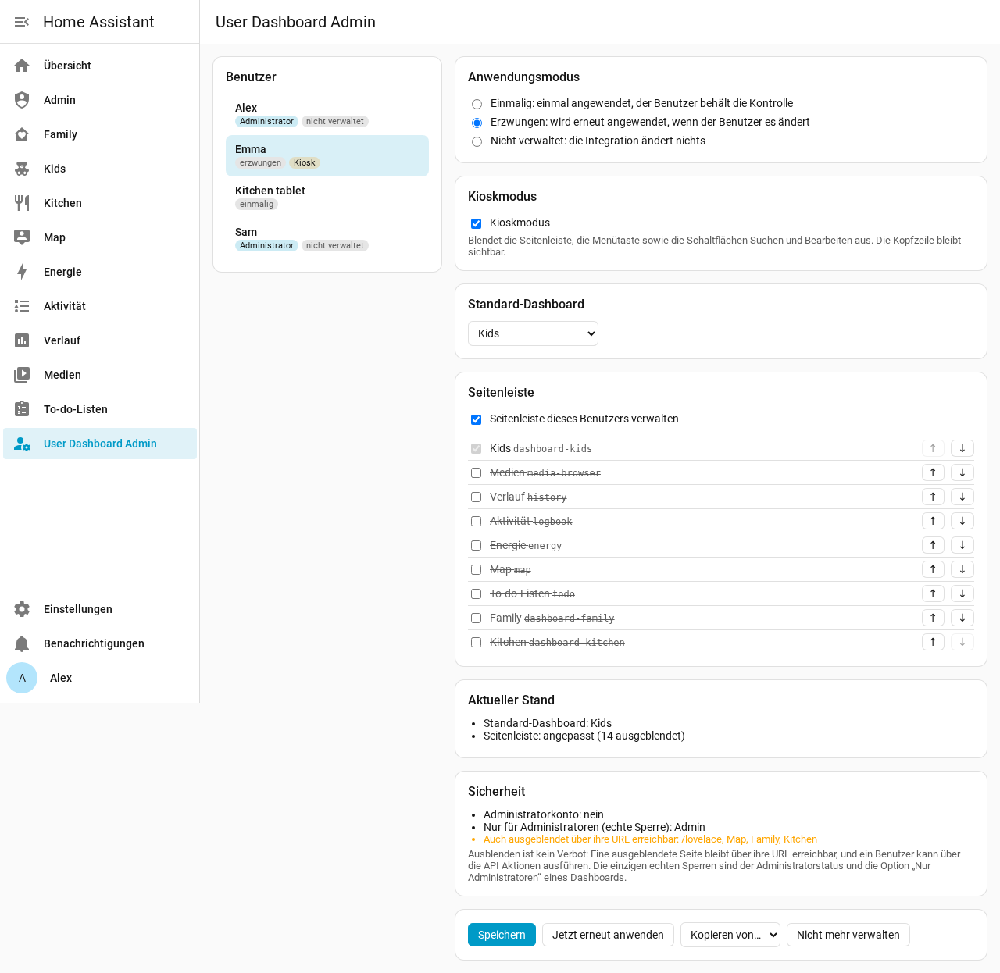
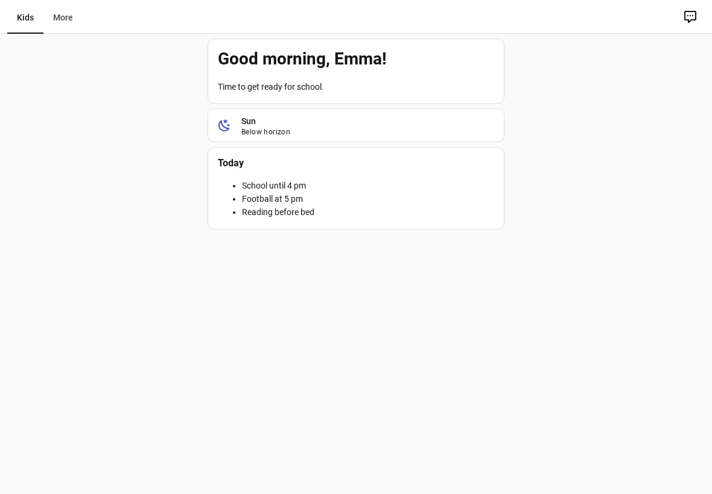

# User Dashboard Admin für Home Assistant

🇬🇧 [Read in English](https://github.com/Patafoin/ha-user-dashboard-admin/blob/main/README.md) · 🇫🇷 [Lire en français](https://github.com/Patafoin/ha-user-dashboard-admin/blob/main/README.fr.md) · 🇪🇸 [Leer en español](https://github.com/Patafoin/ha-user-dashboard-admin/blob/main/README.es.md)

[](https://hacs.xyz/)
[](https://github.com/Patafoin/ha-user-dashboard-admin/releases)
[](https://github.com/Patafoin/ha-user-dashboard-admin/actions/workflows/validate.yml)
[](https://github.com/Patafoin/ha-user-dashboard-admin/actions/workflows/tests.yml)

Lege in **einer einzigen Admin-Konsole** fest, was jeder Home-Assistant-Benutzer sieht: die **Seitenleiste** (welche Einträge, in welcher Reihenfolge), das **Standard-Dashboard** und den **Kioskmodus**. Kein Anmelden mehr mit jedem Konto, und kein browser_mod.



## Warum

Home Assistant lässt jeden Benutzer seine eigene Seitenleiste ordnen und sein Standard-Dashboard wählen, aber ein Administrator kann das nicht für ihn tun. Die üblichen Umwege (browser_mod, custom-sidebar, kiosk-mode) verändern die Seite von innen und gehen bei Frontend-Updates oft kaputt.

User Dashboard Admin geht den umgekehrten Weg:

- **Seitenleiste und Standard-Dashboard** werden auf dem Server in die Benutzereinstellungen geschrieben, die **das offizielle Frontend ohnehin liest** (dieselben, die der Dialog *Seitenleiste bearbeiten* speichert). Das Frontend wendet sie selbst an; offene Tabs werden sofort aktualisiert.
- **Der Kioskmodus** ist der **eigene** Kioskmodus des Frontends. Ein kleines Modul fragt den Server, ob der angemeldete Benutzer im Kioskmodus sein soll, und schaltet ihn ein. Das Seitenlayout wird nicht verändert.

## Funktionen

- Eine Karte pro Benutzer: Einträge der Seitenleiste (sichtbar / ausgeblendet, Reihenfolge), Standard-Dashboard, Kioskmodus.
- Drei Arten, eine Regel anzuwenden:

  | Modus | Was passiert |
  |---|---|
  | **Einmalig** (Standard) | Wird beim Speichern einmal angewendet. Danach kann der Benutzer selbst Änderungen vornehmen, wie im normalen Home Assistant. |
  | **Erzwungen** | Wird erneut angewendet, sobald der Benutzer seine Seitenleiste oder sein Standard-Dashboard ändert. |
  | **Nicht verwaltet** | Die Integration ändert bei diesem Benutzer nichts. |

- **Kioskmodus** pro Benutzer: keine Seitenleiste, keine Menütaste, keine Schaltflächen Suchen und Bearbeiten. Die Kopfzeile (Titel und Ansichts-Tabs) bleibt.
- Ein **Kiosk-Schalter pro Benutzer** (`switch.user_dashboard_admin_kiosk_<benutzer>`), um den Kioskmodus per Automatisierung oder Dashboard ein- und auszuschalten.
- **Schutz für Administratoren**: Ein Administrator behält immer *Einstellungen* und diese Konsole in seiner Seitenleiste und kann nicht in den Kioskmodus versetzt werden.
- Ein Feld **Sicherheit** auf jeder Karte: ob das Konto Administrator ist, welche Dashboards wirklich gesperrt sind (*Nur Administratoren*) und welche ausgeblendeten Dashboards über ihre URL erreichbar bleiben.
- **Kopieren von…** einem anderen Benutzer, **Jetzt erneut anwenden**, **Nicht mehr verwalten**.
- Oberfläche auf Deutsch, Englisch, Französisch und Spanisch, passend zur Home-Assistant-Sprache.

## ⚠️ Ausblenden ist kein Zugriffsschutz

Diese Integration verwaltet, **was Benutzer sehen**, nicht was sie dürfen:

- ein ausgeblendetes Dashboard oder eine ausgeblendete Seite bleibt über die URL erreichbar;
- jeder Benutzer kann über die API jede Aktion ausführen.

Home Assistant hat nur zwei echte Sperren: den **Administrator**-Status eines Kontos und die Option **„Nur Administratoren“** eines Dashboards (*Einstellungen → Dashboards*). Das Feld Sicherheit jeder Karte zeigt sie an.

## Voraussetzungen

- Home Assistant **2026.2 oder neuer** und [Marketplace (HACS)](https://hacs.xyz/).
- Getestet mit 2026.2.3 (automatische Tests), 2026.9.2 (Browsertest auf einer frischen Instanz) und 2026.10.4 (täglicher Einsatz, einschließlich der Android-Companion-App).

## Installation

[](https://my.home-assistant.io/redirect/hacs_repository/?owner=Patafoin&repository=ha-user-dashboard-admin&category=integration)

1. Einstellungen → **Marketplace**, nach **User Dashboard Admin** suchen und **Installieren** wählen. Vor Home Assistant 2026.11 dieselbe Suche in **HACS** ausführen, herunterladen und Home Assistant neu starten.
2. **Einstellungen → Geräte & Dienste → Integration hinzufügen → User Dashboard Admin** (keine Einstellungen nötig).

[](https://my.home-assistant.io/redirect/config_flow_start/?domain=user_dashboard_admin)

**User Dashboard Admin** erscheint dann in der Seitenleiste der Administratoren.

Findet die Suche sie nicht, das Repository über seinen Link hinzufügen: im Marketplace per Link hinzufügen → `https://github.com/Patafoin/ha-user-dashboard-admin`; in HACS ⋮ → **Benutzerdefinierte Repositories** → dieselbe URL, Typ **Integration**.

## Die Konsole verwenden

1. Links einen Benutzer wählen.
2. Den Anwendungsmodus wählen (einmalig, erzwungen, nicht verwaltet).
3. Bei Bedarf **Kioskmodus** ankreuzen (für Administratoren nicht verfügbar).
4. Das **Standard-Dashboard** wählen oder unverändert lassen.
5. **Seitenleiste dieses Benutzers verwalten** ankreuzen, dann die anzuzeigenden Einträge ankreuzen und mit ↑ ↓ ordnen. Das Standard-Dashboard wird immer angezeigt: Das Frontend zeigt es in jedem Fall.
6. **Speichern**. Das Feld **Aktueller Stand** zeigt, was der Benutzer tatsächlich hat.

Jeder Teil ist optional: Eine Regel, die nur das Standard-Dashboard festlegt, lässt die Seitenleiste unverändert, und umgekehrt.

### Kioskmodus



Der Kioskmodus gilt für **alle Geräte** des Benutzers (er folgt dem Konto, nicht dem Gerät). Er wirkt beim Laden der Seite und sofort, wenn der Schalter umgelegt wird.

Um das Tablet kurz selbst zu benutzen, den Kiosk-Schalter des Benutzers aus- und danach wieder einschalten. Beispiel: Kiosk aus, solange ein *input_boolean* eingeschaltet ist.

```yaml
automation:
  - alias: Küchentablet - Kiosk folgt dem Wartungsmodus
    triggers:
      - trigger: state
        entity_id: input_boolean.tablet_wartung
    actions:
      - action: "switch.turn_{{ 'off' if trigger.to_state.state == 'on' else 'on' }}"
        target:
          entity_id: switch.user_dashboard_admin_kiosk_kuchentablet
```

## Entitäten

| Entität | Aufgabe |
|---|---|
| `switch.user_dashboard_admin_kiosk_<benutzer>` | Kioskmodus eines Benutzers. Das Einschalten für einen Administrator wird abgelehnt. |

Alle Schalter gehören zu einem einzigen Dienstgerät *User Dashboard Admin*. Ein neuer Benutzer erhält seinen Schalter automatisch.

## Tipps

- **Android-Companion-App**: Wenn der Kioskmodus nach der Installation oder einem Update der Integration auf einem Gerät nicht reagiert, den App-Cache leeren (Android-Einstellungen → Apps → Home Assistant → Speicher → Cache leeren) und die App neu öffnen.
- **browser_mod / kiosk-mode**: deren Seitenleisten- und Kiosk-Einstellungen für die hier verwalteten Benutzer entfernen, sonst wirken beide gleichzeitig.
- **Das Entfernen der Integration** beendet die Regeln und den Kioskmodus. Bereits Geschriebenes bleibt erhalten: Jeder Benutzer kann seine Seitenleiste mit *Seitenleiste bearbeiten* zurücksetzen, oder du erledigst das vorher in der Konsole (**Nicht mehr verwalten** behält die aktuellen Einstellungen).
- **Diagnosedaten** (Seite der Integration → ⋮ → Diagnosedaten herunterladen): Regeln und aktueller Stand pro Benutzer, ohne Namen und Konto-IDs.

## So funktioniert es (für Neugierige)

- Seitenleiste: der Schlüssel `sidebar` (`panelOrder`, `hiddenPanels`) in den Frontend-Daten des Benutzers (`.storage/frontend.user_data_<benutzer-id>`); Standard-Dashboard: `core.default_panel` in derselben Datei, zusammengeführt, damit andere Einstellungen erhalten bleiben.
- Kioskmodus: das Frontend-Ereignis `hass-kiosk-mode`, gesendet von einem Modul, das in jeder Seite geladen wird. Der Server beantwortet `user_dashboard_admin/kiosk/subscribe` nur für den angemeldeten Benutzer.
- Regeln: `.storage/user_dashboard_admin`. Erzwungene Regeln überwachen Änderungen an den Frontend-Daten des Benutzers.

Das sind interne Teile von Home Assistant. Automatische Tests laufen jede Woche gegen die neueste Version, um eine Änderung früh zu bemerken.

## Lizenz

[MIT](LICENSE)
