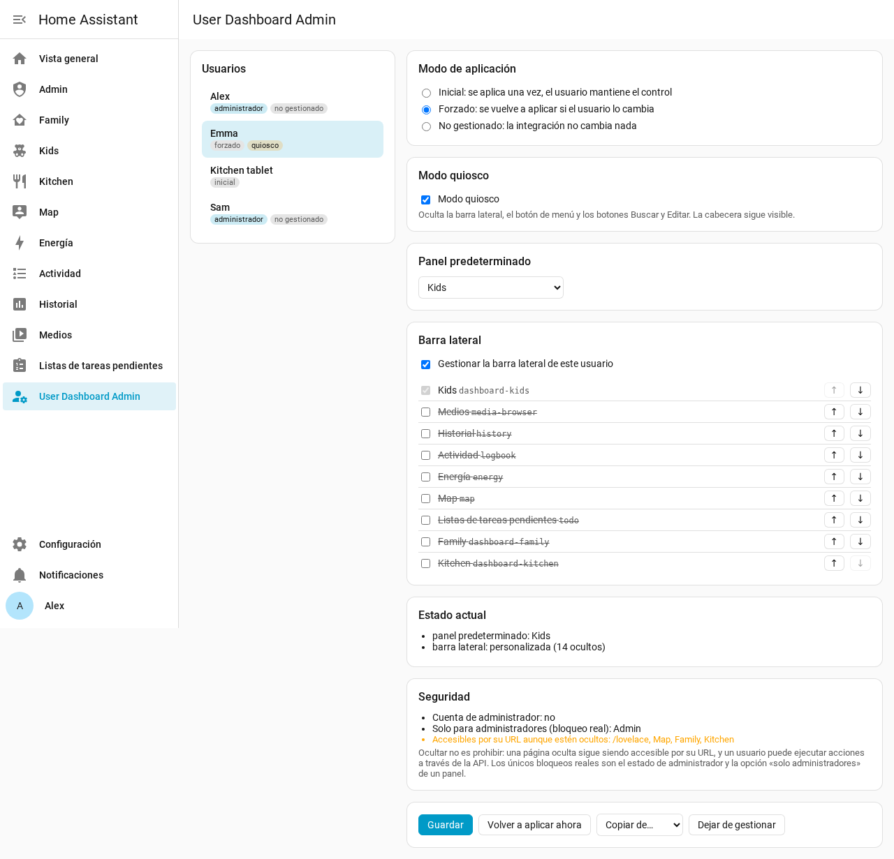
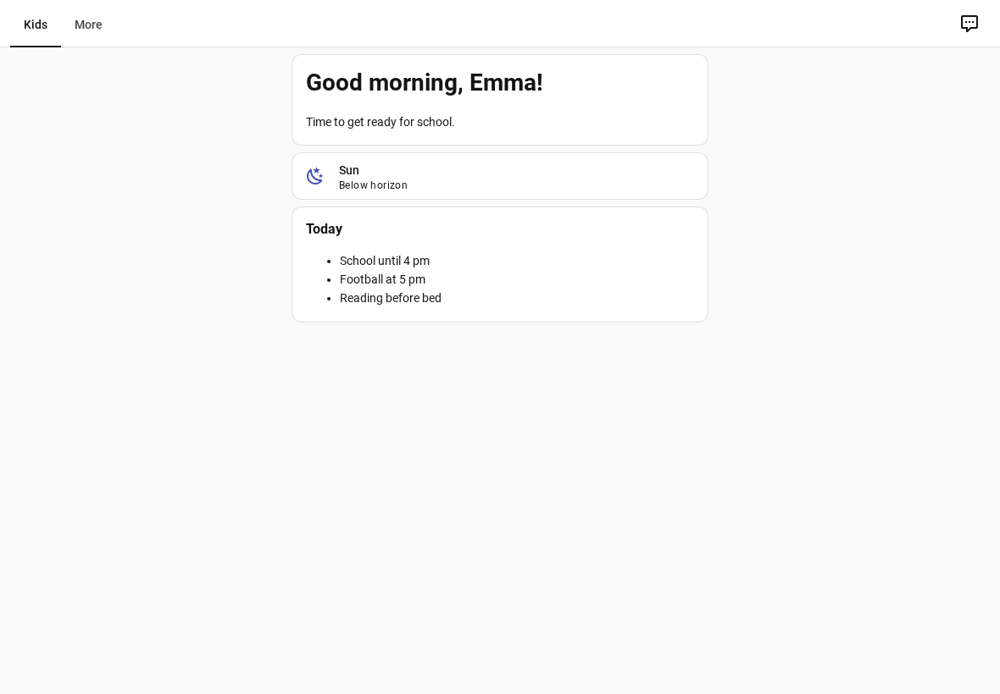

# User Dashboard Admin para Home Assistant

🇬🇧 [Read in English](https://github.com/Patafoin/ha-user-dashboard-admin/blob/main/README.md) · 🇫🇷 [Lire en français](https://github.com/Patafoin/ha-user-dashboard-admin/blob/main/README.fr.md) · 🇩🇪 [Auf Deutsch lesen](https://github.com/Patafoin/ha-user-dashboard-admin/blob/main/README.de.md)

[](https://hacs.xyz/)
[](https://github.com/Patafoin/ha-user-dashboard-admin/releases)
[](https://github.com/Patafoin/ha-user-dashboard-admin/actions/workflows/validate.yml)
[](https://github.com/Patafoin/ha-user-dashboard-admin/actions/workflows/tests.yml)

Decide, desde **una sola consola de administración**, qué ve cada usuario de Home Assistant: la **barra lateral** (qué entradas y en qué orden), el **panel predeterminado** y el **modo quiosco**. Sin tener que iniciar sesión con cada cuenta para configurarlo, y sin browser_mod.



## Por qué

Home Assistant permite que cada usuario ordene su propia barra lateral y elija su panel predeterminado, pero un administrador no puede hacerlo por él. Las soluciones habituales (browser_mod, custom-sidebar, kiosk-mode) modifican la página desde dentro y suelen romperse con las actualizaciones del frontend.

User Dashboard Admin lo hace al revés:

- **La barra lateral y el panel predeterminado** se escriben en el servidor, en las preferencias por usuario que **el frontend oficial ya lee** (las mismas que guarda el diálogo *Editar barra lateral*). El propio frontend las aplica; las pestañas abiertas se actualizan al instante.
- **El modo quiosco** es el modo quiosco **nativo** del frontend. Un pequeño módulo pregunta al servidor si el usuario conectado debe estar en modo quiosco y lo activa. No modifica el diseño de la página.

## Funciones

- Una ficha por usuario: entradas de la barra lateral (visibles u ocultas, orden), panel predeterminado, modo quiosco.
- Tres formas de aplicar una regla:

  | Modo | Qué ocurre |
  |---|---|
  | **Inicial** (predeterminado) | Se aplica una vez al guardar. Después el usuario puede cambiar sus ajustes, como en Home Assistant estándar. |
  | **Forzado** | Se vuelve a aplicar en cuanto el usuario cambia su barra lateral o su panel predeterminado. |
  | **No gestionado** | La integración no toca a este usuario. |

- **Modo quiosco** por usuario: sin barra lateral, sin botón de menú, sin botones Buscar ni Editar. La cabecera (título y pestañas de las vistas) sigue visible.
- Un **interruptor de quiosco por usuario** (`switch.user_dashboard_admin_quiosco_<usuario>`), para activar o desactivar el modo quiosco desde automatizaciones o un panel.
- **Protecciones para administradores**: un administrador siempre conserva *Ajustes* y esta consola en su barra lateral, y no puede ponerse en modo quiosco.
- Un recuadro **Seguridad** en cada ficha: si la cuenta es de administrador, qué paneles están realmente bloqueados (*solo administradores*) y qué paneles ocultos siguen siendo accesibles por su URL.
- **Copiar de…** otro usuario, **Volver a aplicar ahora**, **Dejar de gestionar**.
- Interfaz en español, inglés, francés y alemán, según el idioma de Home Assistant.

## ⚠️ Ocultar no es restringir el acceso

Esta integración gestiona **lo que ven los usuarios**, no lo que pueden hacer:

- un panel o una página ocultos siguen siendo accesibles por su URL;
- cualquier usuario puede ejecutar cualquier acción a través de la API.

Home Assistant solo tiene dos bloqueos reales: el estado de **administrador** de una cuenta y la opción **«solo administradores»** de un panel (*Ajustes → Paneles de control*). El recuadro Seguridad de cada ficha los muestra.

## Requisitos

- Home Assistant **2026.2 o posterior** y [Marketplace (HACS)](https://hacs.xyz/).
- Probada con 2026.2.3 (pruebas automáticas), 2026.9.2 (prueba en navegador sobre una instancia nueva) y 2026.10.4 (uso diario, incluida la app Companion de Android).

## Instalación

[](https://my.home-assistant.io/redirect/hacs_repository/?owner=Patafoin&repository=ha-user-dashboard-admin&category=integration)

1. Ajustes → **Marketplace**, busca **User Dashboard Admin** y selecciona **Instalar**. Antes de Home Assistant 2026.11, haz la misma búsqueda en **HACS**, descárgala y reinicia Home Assistant.
2. **Ajustes → Dispositivos y servicios → Añadir integración → User Dashboard Admin** (no hay nada que rellenar).

[](https://my.home-assistant.io/redirect/config_flow_start/?domain=user_dashboard_admin)

**User Dashboard Admin** aparece entonces en la barra lateral de los administradores.

Si la búsqueda no la encuentra, añade el repositorio por su enlace: en el Marketplace, añadir desde un enlace → `https://github.com/Patafoin/ha-user-dashboard-admin`; en HACS, ⋮ → **Repositorios personalizados** → la misma URL, tipo **Integración**.

## Usar la consola

1. Elige un usuario a la izquierda.
2. Elige el modo de aplicación (inicial, forzado, no gestionado).
3. Marca **Modo quiosco** si hace falta (no disponible para administradores).
4. Elige el **panel predeterminado** o déjalo como está.
5. Marca **Gestionar la barra lateral de este usuario**, luego marca las entradas que se mostrarán y ordénalas con ↑ ↓. El panel predeterminado siempre se muestra: el frontend lo muestra en cualquier caso.
6. **Guardar**. El recuadro **Estado actual** muestra lo que el usuario tiene realmente.

Cada parte es opcional: una regla que solo fija el panel predeterminado no toca la barra lateral, y al revés.

### Modo quiosco



El modo quiosco se aplica a **todos los dispositivos** del usuario (sigue a la cuenta, no al dispositivo). Surte efecto al cargar la página, y al instante al cambiar el interruptor.

Para usar la tableta tú mismo un momento, desactiva el interruptor de quiosco del usuario y vuelve a activarlo después. Ejemplo: quiosco desactivado mientras un *input_boolean* esté encendido.

```yaml
automation:
  - alias: Tableta cocina - quiosco según el modo mantenimiento
    triggers:
      - trigger: state
        entity_id: input_boolean.tableta_mantenimiento
    actions:
      - action: "switch.turn_{{ 'off' if trigger.to_state.state == 'on' else 'on' }}"
        target:
          entity_id: switch.user_dashboard_admin_quiosco_tableta_cocina
```

## Entidades

| Entidad | Función |
|---|---|
| `switch.user_dashboard_admin_quiosco_<usuario>` | Modo quiosco de un usuario. Activarlo para un administrador se rechaza. |

Todos los interruptores pertenecen a un único dispositivo de servicio *User Dashboard Admin*. Un usuario nuevo recibe su interruptor automáticamente.

## Consejos

- **App Companion de Android**: si después de instalar o actualizar la integración el modo quiosco no reacciona en un dispositivo, borra la caché de la app (Ajustes de Android → Aplicaciones → Home Assistant → Almacenamiento → Borrar caché) y vuelve a abrirla.
- **browser_mod / kiosk-mode**: quita sus ajustes de barra lateral y de quiosco para los usuarios gestionados aquí; si no, ambos actúan a la vez.
- **Eliminar la integración** detiene las reglas y el modo quiosco. Lo que ya se escribió se mantiene: cada usuario puede restablecer su barra con *Editar barra lateral*, o puedes hacerlo desde la consola antes de eliminarla (**Dejar de gestionar** conserva los ajustes actuales).
- **Diagnósticos** (página de la integración → ⋮ → Descargar diagnósticos): reglas y estado actual por usuario, sin nombres ni identificadores de cuenta.

## Cómo funciona (para curiosos)

- Barra lateral: la clave `sidebar` (`panelOrder`, `hiddenPanels`) de los datos de frontend del usuario (`.storage/frontend.user_data_<id de usuario>`); panel predeterminado: `core.default_panel` en el mismo archivo, combinado para conservar las demás preferencias.
- Modo quiosco: el evento `hass-kiosk-mode` del frontend, enviado por un módulo cargado en todas las páginas. El servidor responde a `user_dashboard_admin/kiosk/subscribe` solo para el usuario conectado.
- Reglas: `.storage/user_dashboard_admin`. Las reglas forzadas vigilan los cambios en los datos de frontend del usuario.

Son partes internas de Home Assistant. Unas pruebas automáticas se ejecutan cada semana con la última versión para detectar pronto un cambio.

## Licencia

[MIT](LICENSE)
