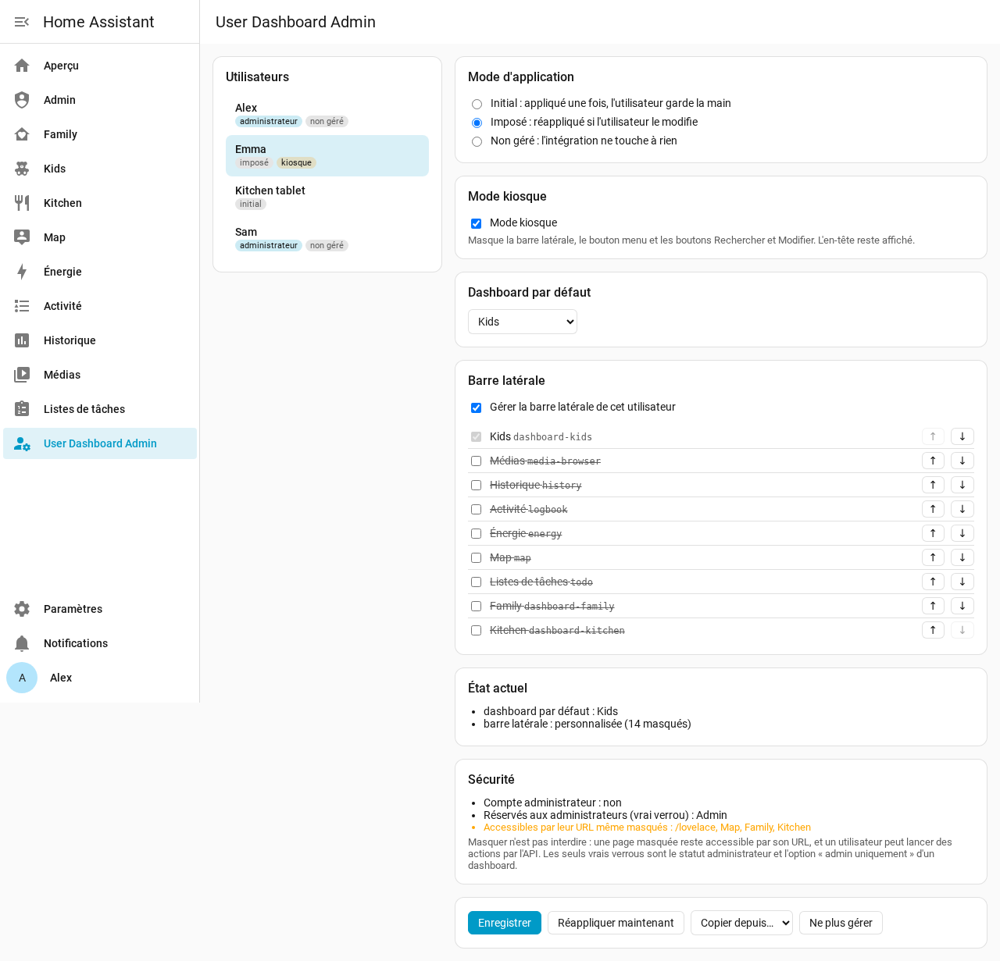
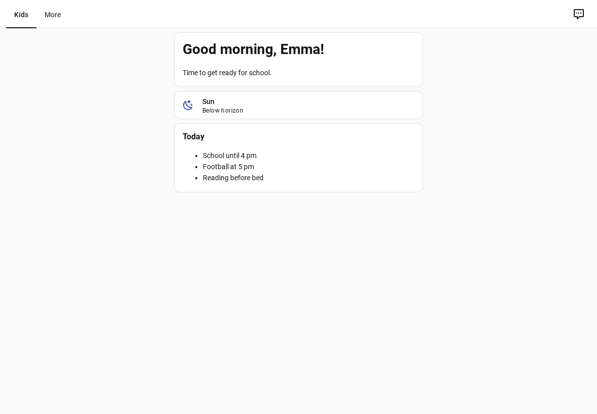

# User Dashboard Admin pour Home Assistant

🇬🇧 [Read in English](https://github.com/Patafoin/ha-user-dashboard-admin/blob/main/README.md) · 🇩🇪 [Auf Deutsch lesen](https://github.com/Patafoin/ha-user-dashboard-admin/blob/main/README.de.md) · 🇪🇸 [Leer en español](https://github.com/Patafoin/ha-user-dashboard-admin/blob/main/README.es.md)

[](https://hacs.xyz/)
[](https://github.com/Patafoin/ha-user-dashboard-admin/releases)
[](https://github.com/Patafoin/ha-user-dashboard-admin/actions/workflows/validate.yml)
[](https://github.com/Patafoin/ha-user-dashboard-admin/actions/workflows/tests.yml)

Décidez, depuis **une seule console d'administration**, de ce que voit chaque utilisateur de Home Assistant : la **barre latérale** (quelles entrées, dans quel ordre), le **dashboard par défaut** et le **mode kiosque**. Plus besoin de vous connecter avec chaque compte pour tout régler.



## Pourquoi

Home Assistant laisse chaque utilisateur ranger sa propre barre latérale et choisir son dashboard par défaut, mais un administrateur ne peut pas le faire à sa place.

User Dashboard Admin permet à l'administrateur de le faire depuis une seule console :

- **Barre latérale et dashboard par défaut** sont écrits côté serveur, dans les préférences par utilisateur que **le frontend officiel lit déjà** (celles qu'enregistre la fenêtre *Modifier la barre latérale*). C'est le frontend qui les applique ; les onglets ouverts se mettent à jour aussitôt.
- **Le mode kiosque** est le mode kiosque **natif** du frontend. Un petit module demande au serveur si l'utilisateur connecté doit être en kiosque, et l'active. Il ne touche pas à la mise en page.
- Les réglages suivent le **compte utilisateur** : ils s'appliquent à tous les appareils de cet utilisateur. Pour des réglages différents par **appareil** pour un même utilisateur, voir [browser_mod](https://github.com/thomasloven/hass-browser_mod).

## Fonctionnalités

- Une fiche par utilisateur : entrées de la barre latérale (visibles ou masquées, ordre), dashboard par défaut, mode kiosque.
- Trois façons d'appliquer une règle :

  | Mode | Ce qui se passe |
  |---|---|
  | **Initial** (par défaut) | Appliquée une fois, à l'enregistrement. L'utilisateur peut ensuite modifier ses réglages, comme dans Home Assistant standard. |
  | **Imposé** | Réappliquée dès que l'utilisateur modifie sa barre latérale ou son dashboard par défaut. |
  | **Non géré** | L'intégration ne touche pas à cet utilisateur. |

- **Mode kiosque** par utilisateur : pas de barre latérale, pas de bouton menu, pas de boutons Rechercher ni Modifier. L'en-tête (titre et onglets des vues) reste affiché.
- Un **interrupteur kiosque par utilisateur** (`switch.user_dashboard_admin_kiosque_<utilisateur>`), pour activer ou couper le kiosque depuis une automatisation ou un dashboard.
- **Garde-fous pour les administrateurs** : un administrateur garde toujours *Paramètres* et cette console dans sa barre latérale, et ne peut pas être mis en kiosque.
- Un encart **Sécurité** sur chaque fiche : compte administrateur ou non, dashboards vraiment verrouillés (*admin uniquement*), dashboards masqués mais accessibles par leur URL.
- **Copier depuis…** un autre utilisateur, **Réappliquer maintenant**, **Ne plus gérer**.
- Interface en français, anglais, allemand et espagnol, selon la langue de Home Assistant.

## ⚠️ Masquer n'est pas interdire

Cette intégration gère **ce que les utilisateurs voient**, pas ce qu'ils ont le droit de faire :

- un dashboard ou une page masqués restent accessibles par leur URL ;
- n'importe quel utilisateur peut lancer n'importe quelle action par l'API.

Home Assistant n'a que deux vrais verrous : le statut **administrateur** d'un compte, et l'option **« admin uniquement »** d'un dashboard (*Paramètres → Tableaux de bord*). L'encart Sécurité de chaque fiche les affiche.

## Prérequis

- Home Assistant **2026.2 ou plus récent**, et [Marketplace (HACS)](https://hacs.xyz/).
- Testée sur 2026.2.3 (tests automatiques), 2026.9.2 (test dans un navigateur sur une instance neuve) et 2026.10.4 (usage quotidien, appli Companion Android comprise).

## Installation

[](https://my.home-assistant.io/redirect/hacs_repository/?owner=Patafoin&repository=ha-user-dashboard-admin&category=integration)

1. Paramètres → **Marketplace**, cherchez **User Dashboard Admin** et sélectionnez **Installer**. Avant Home Assistant 2026.11, faites la même recherche dans **HACS**, téléchargez-la, puis redémarrez Home Assistant.
2. **Paramètres → Appareils et services → Ajouter une intégration → User Dashboard Admin** (aucun réglage à saisir).

[](https://my.home-assistant.io/redirect/config_flow_start/?domain=user_dashboard_admin)

**User Dashboard Admin** apparaît alors dans la barre latérale des administrateurs.

Si la recherche ne la trouve pas, ajoutez le dépôt par son lien : dans la Marketplace, ajout depuis un lien → `https://github.com/Patafoin/ha-user-dashboard-admin` ; dans HACS, ⋮ → **Dépôts personnalisés** → la même URL, type **Intégration**.

## Utiliser la console

1. Choisissez un utilisateur à gauche.
2. Choisissez le mode d'application (initial, imposé, non géré).
3. Cochez **Mode kiosque** si besoin (indisponible pour un administrateur).
4. Choisissez le **dashboard par défaut**, ou laissez-le tel quel.
5. Cochez **Gérer la barre latérale de cet utilisateur**, puis cochez les entrées à afficher et rangez-les avec ↑ ↓. Le dashboard par défaut reste toujours affiché : le frontend l'affiche dans tous les cas.
6. **Enregistrer**. L'encart **État actuel** montre ce que l'utilisateur a réellement.

Chaque partie est facultative : une règle qui ne règle que le dashboard par défaut ne touche pas à la barre latérale, et inversement.

### Mode kiosque



Le kiosque s'applique à **tous les appareils** de l'utilisateur (il suit le compte, pas l'appareil). Il prend effet au chargement de la page, et à chaud quand on bascule l'interrupteur.

Pour vous servir de la tablette un moment, coupez l'interrupteur kiosque de l'utilisateur, puis rallumez-le. Exemple : kiosque coupé tant qu'un *input_boolean* est allumé.

```yaml
automation:
  - alias: Tablette cuisine - kiosque selon le mode maintenance
    triggers:
      - trigger: state
        entity_id: input_boolean.tablette_maintenance
    actions:
      - action: "switch.turn_{{ 'off' if trigger.to_state.state == 'on' else 'on' }}"
        target:
          entity_id: switch.user_dashboard_admin_kiosque_tablette_cuisine
```

## Entités

| Entité | Rôle |
|---|---|
| `switch.user_dashboard_admin_kiosque_<utilisateur>` | Mode kiosque d'un utilisateur. L'allumer pour un administrateur est refusé. |

Les interrupteurs sont rattachés à un unique appareil de service *User Dashboard Admin*. Un nouvel utilisateur reçoit son interrupteur automatiquement.

## Conseils

- **Appli Companion Android** : après l'installation ou une mise à jour de l'intégration, si le kiosque ne réagit pas sur un appareil, videz le cache de l'appli (Paramètres Android → Applications → Home Assistant → Stockage → Vider le cache) et rouvrez-la.
- **browser_mod / kiosk-mode** : si vous les utilisez aussi, ne gérez pas les mêmes réglages de barre latérale ou de kiosque pour le même utilisateur aux deux endroits, sinon ils se superposent.
- **Supprimer l'intégration** arrête les règles et le kiosque. Ce qui a été écrit reste en place : chaque utilisateur peut réinitialiser sa barre avec *Modifier la barre latérale*, ou vous pouvez le faire depuis la console avant la suppression (**Ne plus gérer** conserve les réglages actuels).
- **Diagnostics** (page de l'intégration → ⋮ → Télécharger les diagnostics) : règles et état actuel par utilisateur, sans les noms ni les identifiants de compte.

## Comment ça marche (pour les curieux)

- Barre latérale : clé `sidebar` (`panelOrder`, `hiddenPanels`) des données frontend de l'utilisateur (`.storage/frontend.user_data_<id utilisateur>`) ; dashboard par défaut : `core.default_panel` dans le même fichier, fusionné pour garder les autres préférences.
- Mode kiosque : événement `hass-kiosk-mode` du frontend, émis par un module chargé dans toutes les pages. Le serveur répond à `user_dashboard_admin/kiosk/subscribe` pour l'utilisateur connecté seulement.
- Règles : `.storage/user_dashboard_admin`. Les règles imposées écoutent les modifications des données frontend de l'utilisateur.

Ce sont des parties internes de Home Assistant. Des tests automatiques tournent chaque semaine sur la dernière version pour repérer tôt un changement.

## Licence

[MIT](LICENSE)
