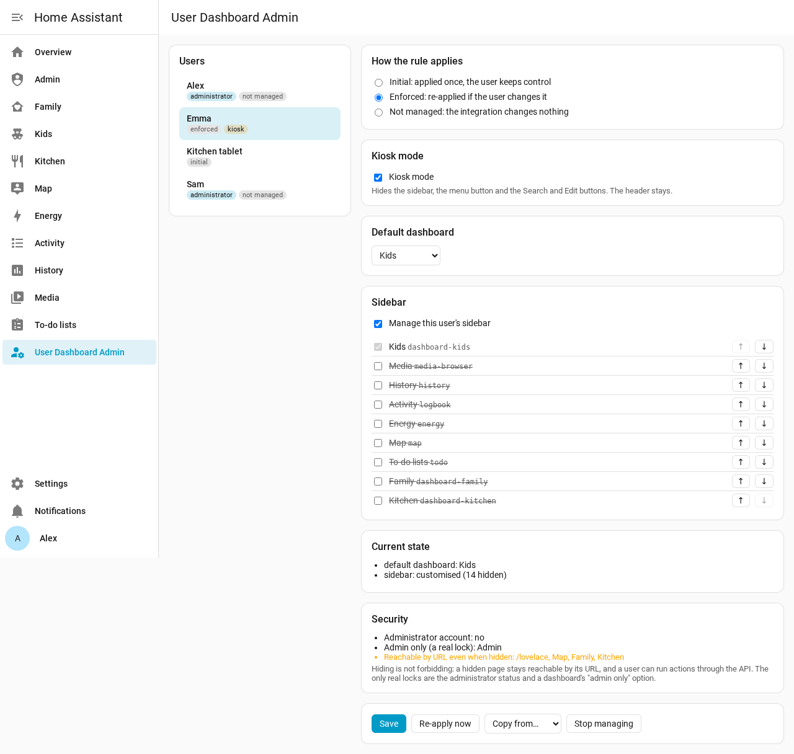
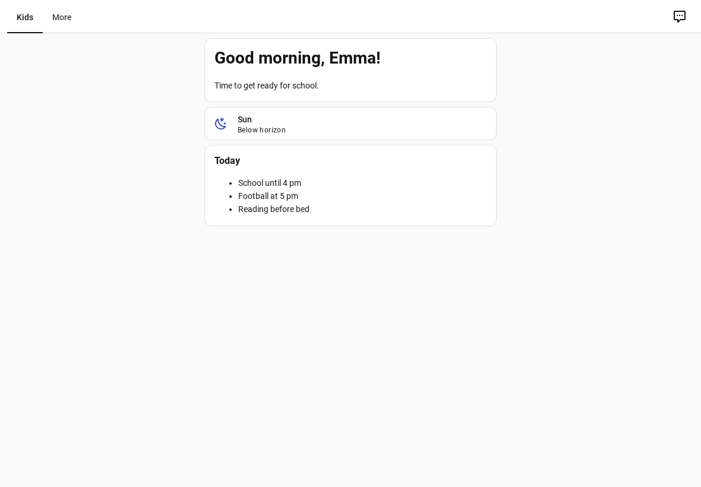

# User Dashboard Admin for Home Assistant

🇫🇷 [Lire en français](https://github.com/Patafoin/ha-user-dashboard-admin/blob/main/README.fr.md) · 🇩🇪 [Auf Deutsch lesen](https://github.com/Patafoin/ha-user-dashboard-admin/blob/main/README.de.md) · 🇪🇸 [Leer en español](https://github.com/Patafoin/ha-user-dashboard-admin/blob/main/README.es.md)

[](https://hacs.xyz/)
[](https://github.com/Patafoin/ha-user-dashboard-admin/releases)
[](https://github.com/Patafoin/ha-user-dashboard-admin/actions/workflows/validate.yml)
[](https://github.com/Patafoin/ha-user-dashboard-admin/actions/workflows/tests.yml)

Decide, from **one admin console**, what each Home Assistant user sees: the **sidebar** (which entries, in which order), the **default dashboard**, and **kiosk mode**. No more logging in with every account to set things up, and no browser_mod.



## Why

Home Assistant lets every user tidy their own sidebar and pick their own default dashboard, but an administrator cannot do it for them. The usual workarounds (browser_mod, custom-sidebar, kiosk-mode) patch the page from the inside, so they tend to break with frontend updates.

User Dashboard Admin works the other way round:

- **Sidebar and default dashboard** are written on the server, into the per-user preferences the **official frontend already reads** (the same ones the *Edit sidebar* dialog saves). The frontend applies them itself; open tabs update immediately.
- **Kiosk mode** is the frontend's **own** kiosk mode. A tiny module asks the server whether the current user should be in kiosk mode and turns it on. It does not touch the page layout.

## Features

- One card per user: sidebar entries (visible / hidden, order), default dashboard, kiosk mode.
- Three ways to apply a rule:

  | Mode | What happens |
  |---|---|
  | **Initial** (default) | Applied once when you save. The user can change things afterwards, as in standard Home Assistant. |
  | **Enforced** | Re-applied as soon as the user changes their sidebar or default dashboard. |
  | **Not managed** | The integration does not touch this user. |

- **Kiosk mode** per user: no sidebar, no menu button, no Search or Edit buttons. The header (title and view tabs) stays.
- A **kiosk switch per user** (`switch.user_dashboard_admin_kiosk_<user>`), to turn kiosk mode on and off from automations or a dashboard.
- **Safeguards for administrators**: an administrator always keeps *Settings* and this console in their sidebar, and cannot be put in kiosk mode.
- A **Security** box on every card: whether the account is an administrator, which dashboards are really locked (*admin only*), and which hidden dashboards remain reachable by URL.
- **Copy from…** another user, **Re-apply now**, **Stop managing**.
- Interface in English, French, German and Spanish, following the Home Assistant language.

## ⚠️ Hiding is not access control

This integration manages **what users see**, not what they are allowed to do:

- a hidden dashboard or page is still reachable by its URL;
- any user can call any action through the API.

Home Assistant has only two real locks: the **administrator** status of an account, and the **"admin only"** option of a dashboard (*Settings → Dashboards*). The Security box of each card shows them.

## Requirements

- Home Assistant **2026.2 or later**, and [HACS](https://hacs.xyz/).
- Tested on 2026.2.3 (automated tests), 2026.9.2 (browser test on a fresh instance) and 2026.10.4 (daily use, including the Android Companion app).

## Installation

[](https://my.home-assistant.io/redirect/hacs_repository/?owner=Patafoin&repository=ha-user-dashboard-admin&category=integration)

1. In HACS: ⋮ → **Custom repositories** → `https://github.com/Patafoin/ha-user-dashboard-admin`, type **Integration**.
2. Download **User Dashboard Admin**, then restart Home Assistant.
3. **Settings → Devices & services → Add integration → User Dashboard Admin** (no settings to fill in).

[](https://my.home-assistant.io/redirect/config_flow_start/?domain=user_dashboard_admin)

**User Dashboard Admin** then appears in the sidebar of administrators.

## Using the console

1. Pick a user on the left.
2. Choose how the rule applies (initial, enforced, not managed).
3. Tick **Kiosk mode** if needed (not available for administrators).
4. Pick the **default dashboard**, or leave it as is.
5. Tick **Manage this user's sidebar**, then tick the entries to show and order them with ↑ ↓. The default dashboard is always shown: the frontend displays it in any case.
6. **Save**. The **Current state** box shows what the user actually has.

Each part is optional: a rule that only sets the default dashboard leaves the sidebar alone, and the other way round.

### Kiosk mode



Kiosk mode applies to **every device** of the user (it follows the account, not the device). It takes effect when the page loads, and live when you flip the switch.

To use the tablet yourself for a moment, turn the user's kiosk switch off, then back on. Example: kiosk off while an *input_boolean* is on.

```yaml
automation:
  - alias: Kitchen tablet - kiosk follows maintenance mode
    triggers:
      - trigger: state
        entity_id: input_boolean.tablet_maintenance
    actions:
      - action: "switch.turn_{{ 'off' if trigger.to_state.state == 'on' else 'on' }}"
        target:
          entity_id: switch.user_dashboard_admin_kiosk_kitchen_tablet
```

## Entities

| Entity | Role |
|---|---|
| `switch.user_dashboard_admin_kiosk_<user>` | Kiosk mode of one user. Turning it on for an administrator is refused. |

All switches belong to a single *User Dashboard Admin* service device. A new user gets their switch automatically.

## Tips

- **Android Companion app**: after installing or updating the integration, if kiosk mode does not react on a device, clear the app cache (Android settings → Apps → Home Assistant → Storage → Clear cache) and reopen it.
- **browser_mod / kiosk-mode**: remove their sidebar and kiosk settings for the users you manage here, otherwise both act at the same time.
- **Removing the integration** stops the rules and kiosk mode. What was written stays in place: each user can reset their sidebar with *Edit sidebar*, or you can do it from the console before removing it (**Stop managing** keeps the current settings).
- **Diagnostics** (integration page → ⋮ → Download diagnostics) list the rules and the current state per user, without user names or account ids.

## How it works (for the curious)

- Sidebar: the `sidebar` key (`panelOrder`, `hiddenPanels`) of the user's frontend data (`.storage/frontend.user_data_<user id>`); default dashboard: `core.default_panel` in the same file, merged so other preferences are kept.
- Kiosk mode: the frontend's `hass-kiosk-mode` event, sent by a module loaded in every page. The server answers `user_dashboard_admin/kiosk/subscribe` for the connected user only.
- Rules: `.storage/user_dashboard_admin`. Enforced rules listen to changes of the user's frontend data.

These are internal parts of Home Assistant. Automated tests run every week against the latest release to catch a change early.

## License

[MIT](LICENSE)
